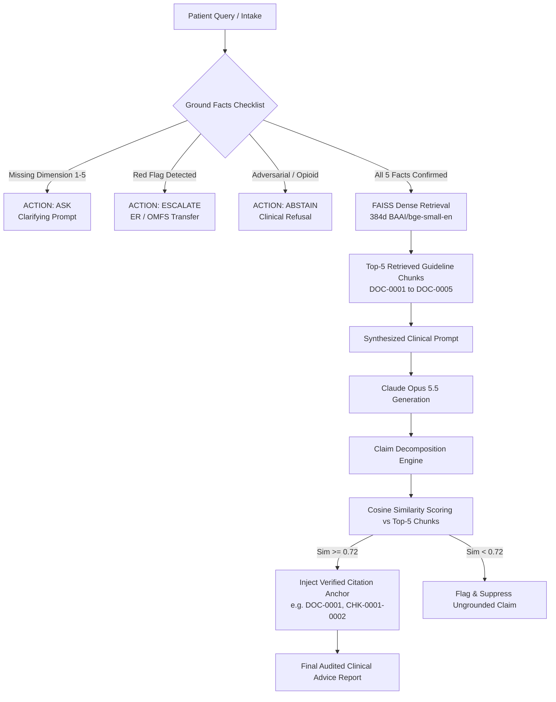

# SafeDental: Clinical Ground Facts & RAG Guidelines Knowledge Base

This document provides a comprehensive technical and clinical specification of the **Ground Facts Checklist** and the **RAG Clinical Guidelines Corpus** integrated into the **SafeDental** clinical decision support system.

---

## 1. Executive Summary & Clinical Architecture

Naive LLM implementations in healthcare suffer from catastrophic failure modes:
1. **Empirical Overprescribing**: Indiscriminately prescribing antibiotics for simple toothaches (pulpitis), directly causing microbial resistance and *Clostridioides difficile* colitis.
2. **Delayed Emergency Escalation**: Recommending home remedies or outpatient appointments for rapidly spreading fascial space phlegmons (Ludwig's Angina).
3. **Hallucinated Clinical Regimens**: Recommending conflicting dosages, dangerous drug interactions, or scheduled narcotics.

SafeDental eliminates these hazards through a **two-tier clinical evidence architecture**:
- **Tier 1: Clinical Ground Facts Checklist**: 5 mandatory diagnostic dimensions required before any advice is generated. If any fact is missing, the system executes an automated `ASK` clarifying intake action; if red flags appear, it triggers an immediate `ESCALATE` action.
- **Tier 2: RAG Authoritative Guidelines Corpus**: 5 internationally validated clinical guidelines (`DOC-0001` through `DOC-0005`) chunked, embedded via dense 384-dimensional vectors, and indexed in FAISS for claim-level verification and citation grounding.

---

## 2. Visual Architecture Diagrams

The system architecture and knowledge base are visually rendered in two publication-grade diagrams:

1. **RAG Clinical Guidelines Corpus Diagram**:
   - Path: [`docs/SafeDental_RAG_Guidelines_Corpus_Diagram.png`](file:///Users/rishabhsingh/Desktop/MAJOR%20PROJ/docs/SafeDental_RAG_Guidelines_Corpus_Diagram.png)
   - Depicts the end-to-end ingestion pipeline, section-aware chunking, embedding generation, FAISS IndexFlatIP search, and the 5 authoritative guidelines.

2. **Clinical Ground Facts Checklist & Evidence Grounding Diagram**:
   - Path: [`docs/SafeDental_RAG_Guidelines_Corpus_Diagram.png`](file:///Users/rishabhsingh/Desktop/MAJOR%20PROJ/docs/SafeDental_Clinical_Ground_Facts_Checklist_Diagram.png)
   - Depicts the 5 mandatory intake dimensions, safety precedence triage rules (`ESCALATE`, `ASK`, `ABSTAIN`), and the claim-level verification matrix.

---

## 3. The 5 Mandatory Clinical Ground Facts Dimensions

Before SafeDental executes clinical RAG or invokes the language model, the **Ground Facts Evaluator** verifies that the patient intake covers all 5 diagnostic dimensions:

| Dimension | Clinical Dimension Name | Required Data Elements | Clinical Rationale | Safety Precedence Rule |
| :--- | :--- | :--- | :--- | :--- |
| **DIM 1** | **Chief Complaint & Anatomical Site** | Exact tooth number (#1 to #32 / FDI 11-48), specific quadrant, primary symptom. | Localizes the exact odontogenic origin; prevents generalized guessing or incorrect tooth intervention. | If missing tooth site: `ACTION: ASK` ("Which specific tooth or quadrant is causing discomfort?") |
| **DIM 2** | **Onset Timeline & Pain Trajectory** | Duration (acute <48h, subacute days, chronic weeks), progression (worsening, intermittent, constant). | Differentiates reversible pulpitis from necrotic pulp, acute periapical abscess, or chronic periodontitis. | If missing duration: `ACTION: ASK` ("How many hours or days have you had this tooth pain?") |
| **DIM 3** | **Pain Character & Thermal Triggers** | Thermal response (lingering >10s cold/heat vs transient <3s), spontaneous/nocturnal, postural changes. | Definitive diagnostic indicator for reversible vs irreversible pulpitis requiring pulpectomy. | If missing thermal test: `ACTION: ASK` ("Does cold or hot food/drink trigger pain, and does it linger?") |
| **DIM 4** | **Swelling, Lymph & Systemic Vitals** | Intraoral localized vs extraoral diffuse swelling, lymphadenopathy, fever (>38°C), tachycardia, malaise. | **The single decisive clinical discriminator** determining whether antibiotics are indicated or contraindicated. | If missing swelling info: `ACTION: ASK` ("Is there any swelling in your gum, cheek, jaw, or fever?") |
| **DIM 5** | **Medical History & Allergy Profile** | Antibiotic allergy status (Penicillin/Amoxicillin rash vs anaphylaxis), diabetes, immunocompromise, pregnancy. | Prevents lethal allergic anaphylaxis; dictates first-line vs second-line antimicrobial selection. | If missing allergy history: `ACTION: ASK` ("Do you have any drug allergies or medical conditions?") |

### Safety Precedence Engine Rules
- **Rule 1 (`ESCALATE`)**: If any lethal red flag is identified (trismus <20mm, dysphagia, floor of mouth elevation, stridor, or septic fever >38.5°C), immediately short-circuit pipeline to hospital emergency or OMFS. 0 LLM tokens generated.
- **Rule 2 (`ASK`)**: If any of Dimensions 1 to 5 are absent and no red flag exists, output a targeted clarifying intake prompt.
- **Rule 3 (`ABSTAIN`)**: If user input contains adversarial jailbreaks, non-dental queries, or requests for scheduled narcotic analgesics (Oxycodone, Codeine), issue a polite clinical refusal.
- **Rule 4 (`ROUTE TO RAG`)**: Only when all 5 dimensions are confirmed does the pipeline query FAISS and construct the grounded prompt.

---

## 4. The RAG Guidelines Corpus (`DOC-0001` to `DOC-0005`)

The SafeDental knowledge base contains 5 internationally recognized clinical guidelines:

### Guideline Overview

```
data/knowledge_base/
├── metadata/
│   ├── DOC-0001.json   (ADA 2019 Guideline on Antibiotics)
│   ├── DOC-0002.json   (SDCEP 2021 Drug Prescribing & Stewardship)
│   ├── DOC-0003.json   (AAOMS 2020 Emergency Escalation Criteria)
│   ├── DOC-0004.json   (JADA 2022 Acute Dental Analgesia Protocol)
│   └── DOC-0005.json   (NICE 2021 Emergency Referral Criteria)
└── chunks/
    ├── CHK-0001-0001.json to CHK-0001-0005.json  (5 chunks)
    ├── CHK-0002-0001.json to CHK-0002-0003.json  (3 chunks)
    ├── CHK-0003-0001.json to CHK-0003-0002.json  (2 chunks)
    ├── CHK-0004-0001.json to CHK-0004-0002.json  (2 chunks)
    └── CHK-0005-0001.json to CHK-0005-0002.json  (2 chunks)
```

---

### Detailed Guideline Profiles

#### 1. `DOC-0001`: ADA 2019 Antibiotic Use in Odontogenic Infections
- **Issuing Body**: American Dental Association (ADA) Council on Scientific Affairs
- **Evidence Level**: Level I (Systematic Review & Clinical Practice Guideline)
- **Chunks**: 5 Chunks (`CHK-0001-0001` through `CHK-0001-0005`)
- **Key Sections**:
  - `CHK-0001-0001`: Scope, definitions, and pulpal vs periapical emergency distinctions.
  - `CHK-0001-0002`: Strong recommendation **against** antibiotics for immunocompetent adults with symptomatic irreversible pulpitis with or without symptomatic apical periodontitis.
  - `CHK-0001-0003`: Operative debridement (pulpectomy, non-surgical root canal therapy, or extraction) as definitive first-line standard of care.
  - `CHK-0001-0004`: Restrictive indications: Antibiotics are ONLY indicated when systemic symptoms are present (fever >38°C, lymphadenopathy, cellulitis, tachycardia, or severe trismus).
  - `CHK-0001-0005`: First-line antimicrobial regimens, conservative durations (3–7 days until symptoms subside), and penicillin-allergy alternatives.
- **Clinical Utility**: Forms the **core antimicrobial stewardship barrier**, preventing empirical antibiotic prescription for pulpal pain without systemic manifestations.

#### 2. `DOC-0002`: SDCEP 2021 Drug Prescribing for Dentistry
- **Issuing Body**: Scottish Dental Clinical Effectiveness Programme (SDCEP)
- **Evidence Level**: Level I (National Health Service Scotland Clinical Guidance)
- **Chunks**: 3 Chunks (`CHK-0002-0001` through `CHK-0002-0003`)
- **Key Sections**:
  - `CHK-0002-0001`: Acute dental triage protocol and swelling classification (localized intraoral vs diffuse extraoral).
  - `CHK-0002-0002`: Treatment triad: local operative intervention and drainage take absolute priority over pharmacological therapy.
  - `CHK-0002-0003`: Evidence-based antimicrobial dosing schedules: Amoxicillin 500mg TID (or Phenoxymethylpenicillin); second-line Clarithromycin 250–500mg BD or Metronidazole 400mg TID for verified penicillin hypersensitivity.
- **Clinical Utility**: Provides exact pharmaceutical regimens, pediatric adjustments, and clear allergy stratification.

#### 3. `DOC-0003`: AAOMS 2020 Emergency Escalation in Fascial Space Infections
- **Issuing Body**: American Association of Oral and Maxillofacial Surgeons (AAOMS)
- **Evidence Level**: Expert Consensus & Surgical Clinical Protocol
- **Chunks**: 2 Chunks (`CHK-0003-0001` and `CHK-0003-0002`)
- **Key Sections**:
  - `CHK-0003-0001`: Anatomy of deep neck spaces (canine, buccal, submandibular, sublingual, submental, lateral pharyngeal, and retropharyngeal spaces).
  - `CHK-0003-0002`: Pathognomonic Ludwig's Angina red flags: bilateral submandibular board-like hardness, elevation/protrusion of the tongue, stridor, dyspnea, dysphagia, inability to swallow saliva, and inter-incisal opening <20mm. Immediate protocol: emergency surgical airway, IV antibiotic resuscitation, and operating room surgical decompression.
- **Clinical Utility**: Provides authoritative surgical backing for SafeDental's **Zero-Tolerance Emergency Escalation Guard**.

#### 4. `DOC-0004`: JADA 2022 Acute Odontogenic Analgesia Protocol
- **Issuing Body**: Journal of the American Dental Association (JADA)
- **Evidence Level**: Systematic Review & Network Meta-Analysis
- **Chunks**: 2 Chunks (`CHK-0004-0001` and `CHK-0004-0002`)
- **Key Sections**:
  - `CHK-0004-0001`: Efficacy comparison of non-opioid multimodal analgesia vs narcotic combinations.
  - `CHK-0004-0002`: First-line protocol: Ibuprofen (400–600mg) combined with Acetaminophen (500–1000mg) every 6 hours. Proven superior pain relief compared to Codeine/Acetaminophen or Hydrocodone combinations, with dramatically lower risks of nausea, sedation, or addiction. Clear warnings for gastrointestinal bleeding, renal insufficiency, and pregnancy.
- **Clinical Utility**: Enables SafeDental to recommend **safe, non-narcotic pain relief** while deflecting opioid-seeking drug behavior.

#### 5. `DOC-0005`: NICE 2021 Dental Pain & Hospital Referral Criteria
- **Issuing Body**: National Institute for Health and Care Excellence (NICE)
- **Evidence Level**: Level I (UK National Healthcare Standard)
- **Chunks**: 2 Chunks (`CHK-0005-0001` and `CHK-0005-0002`)
- **Key Sections**:
  - `CHK-0005-0001`: Stratified triage between primary dental care, urgent dental care centers, and hospital emergency departments.
  - `CHK-0005-0002`: Hospital admission criteria: Systemic sepsis (qSOFA score >= 2, temperature >38.5°C, altered mental status), periorbital cellulitis / visual impairment, and immunocompromised status with acute odontogenic infection.
- **Clinical Utility**: Governs accurate routing to the appropriate healthcare tier, preventing emergency room congestion while safeguarding patient lives.

---

## 5. RAG Ingestion & Claim-Level Verification Pipeline



---

## 6. Clinical & Viva Examination Defense Summary

When presenting SafeDental to examiners or clinical evaluators, highlight the following:

1. **Why naive LLMs fail**: Off-the-shelf LLMs will prescribe Amoxicillin to ~70% of simple toothache queries because their training data mirrors lay internet forums where people incorrectly treat pain with antibiotics.
2. **How SafeDental fixes this**: By strictly enforcing ADA 2019 (`DOC-0001`) and SDCEP 2021 (`DOC-0002`), SafeDental checks Dimension 4 (Systemic signs / diffuse swelling). Without systemic signs, antibiotics are definitively ruled out, and operative pulpectomy is recommended.
3. **Traceability**: Every recommendation generated by SafeDental includes explicit chunk-level citation anchors (e.g., `[ADA 2019, DOC-0001, CHK-0001-0002]`), allowing clinicians to audit the exact paragraph of medical evidence backing each sentence.
4. **Safety Precedence**: Red flag triage operates upstream of the LLM, guaranteeing zero-latency escalation for life-threatening conditions like Ludwig's Angina without relying on model inference.
